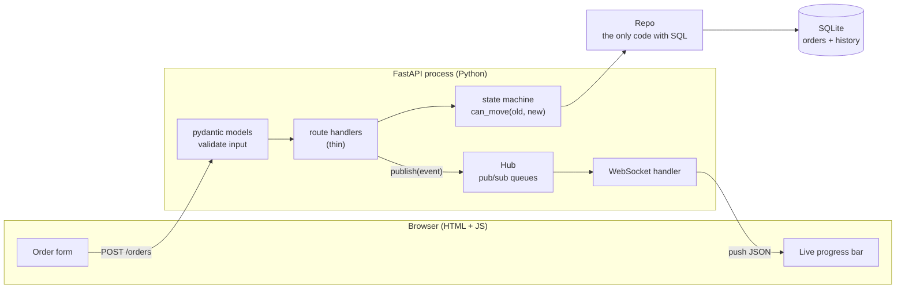
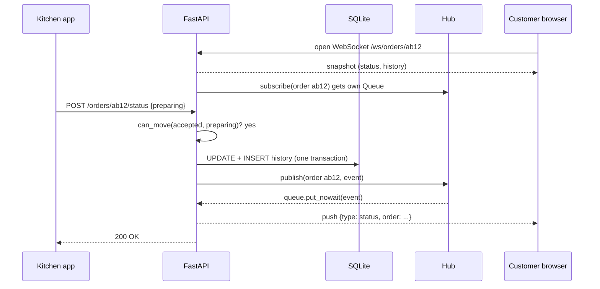
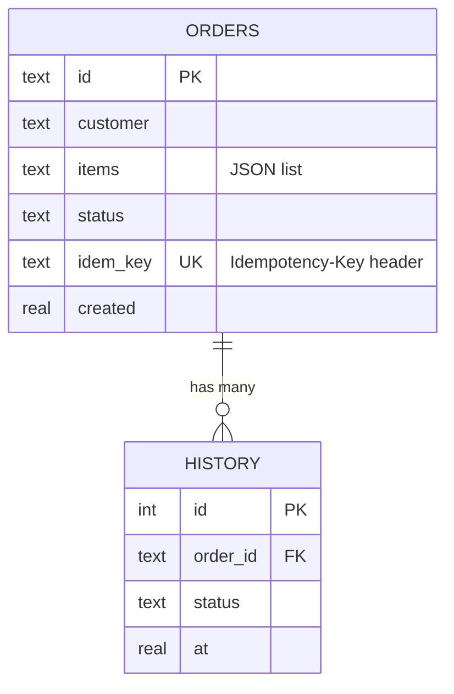
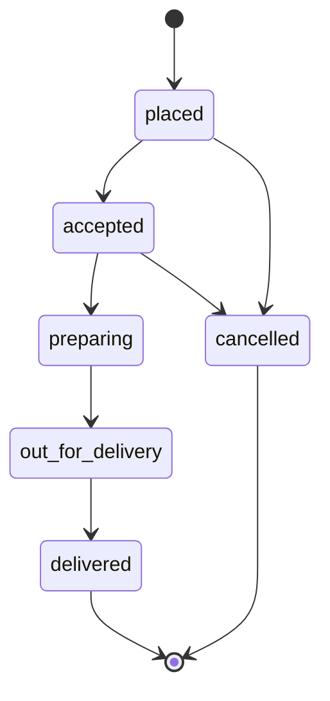

# Blueprint 1 — Live Order Tracker

> **Real-time full-stack backend.** The pattern behind food-delivery, ride-hailing, parcel tracking and ticket-booking apps: one person changes something, everyone watching sees it *instantly*.

**Stack:** Python 3.11 · FastAPI · pydantic · SQLite (`sqlite3`) · WebSockets · asyncio · plain HTML/JS front end
**Files:** `app.py` (the whole system, ~230 lines) · `demo.py` (runs it end to end, no server needed)
**You will have met the prerequisites by:** Day 30 (FastAPI). Parts make sense from Day 19 (classes) and Day 28 (SQL).

---

## 1. What problem is this solving?

A customer places a pizza order. The kitchen accepts it, a driver picks it up, the customer watches a progress bar move. The hard parts are **not** the HTML. They are:

1. **Correctness** — an order must never jump from *delivered* back to *preparing*.
2. **Safe retries** — phones lose signal; the app resends "place order". It must not create two pizzas.
3. **Fan-out** — one status change must reach every open browser tab, quickly, without the server waiting on slow clients.
4. **History** — support will ask "when was it accepted?" (an audit trail).

## 2. The big picture



**Read it left to right:** input is validated → a thin handler asks the state machine for permission → the repository stores it → the hub fans the event out → each open WebSocket pushes it to a browser.

## 3. One request, step by step



## 4. Data model



The `history` table is **append-only**: you never edit the past, you add a row. That one decision gives you an audit trail, debugging, and analytics for free.

## 5. The state machine (the most valuable 12 lines)



In Python it is just a dictionary of sets, and one function:

```python
NEXT = {
    Status.PLACED: {Status.ACCEPTED, Status.CANCELLED},
    Status.ACCEPTED: {Status.PREPARING, Status.CANCELLED},
    Status.PREPARING: {Status.OUT_FOR_DELIVERY},
    Status.OUT_FOR_DELIVERY: {Status.DELIVERED},
    Status.DELIVERED: set(),
    Status.CANCELLED: set(),
}

def can_move(old, new):
    return new in NEXT[old]
```

Why a table and not `if/elif`? Because a table can be **read, tested and drawn**. The diagram above was almost copy-pasted from it.

## 6. API contract

| Method + path | Purpose | Success | Errors |
|---|---|---|---|
| `POST /orders` (+ `Idempotency-Key`) | place an order | `201` (or `200` if the key was seen) | `422` bad body |
| `GET /orders/{id}` | order + history | `200` | `404` |
| `POST /orders/{id}/status` | kitchen / driver moves it | `200` | `404`, `409` illegal move, `422` unknown status |
| `WS /ws/orders/{id}` | live updates | snapshot, then events | closes `4404` if unknown |
| `GET /` | the front-end page | HTML | |

Use the right status code. `409 Conflict` means "your request is valid, but not allowed *right now*". Clients (and humans reading logs) react to it differently than to `422`.

## 7. Where Python does the work

| Python feature | Where it shows up | Course day |
|---|---|---|
| `class X(str, Enum)` | `Status`: typo-proof, JSON-friendly constants | 19–20 |
| dict of sets | the transition table | 9–10 |
| pydantic `BaseModel` + `Field` | `OrderIn`, `MoveIn`: validation without `if` chains | 23, 30 |
| type hints (`str \| None`) | every signature; FastAPI turns them into validation + docs | 23 |
| classes with `__init__` | `Repo` and `Hub` hold state and hide detail | 19 |
| context manager `with self.db:` | a transaction that commits or rolls back as one unit | 17, 28 |
| `sqlite3` + parameters (`?`) | all SQL; the `?` placeholders block SQL injection | 28 |
| `json.dumps / loads` | list of items stored in one column | 13, 16 |
| `uuid`, `time` | ids and timestamps | 18 |
| `async def` / `await` | handlers that wait on sockets without blocking others | beyond Day 30 |
| `asyncio.Queue` | one mailbox per watcher | beyond Day 30 |
| `try / except / finally` | `finally` always unsubscribes a closed socket | 17 |
| closures + dependency injection | `Depends(repo)` hands handlers their collaborators | 11, 22, 30 |

## 8. The patterns, and why each one is here

| Pattern | In this code | Payoff |
|---|---|---|
| **App factory** | `build_app(db_path)` | every test gets a fresh app + empty database |
| **Dependency injection** | `Depends(repo)`, `Depends(hub)` | swap the database or hub in tests without editing handlers |
| **Repository** | class `Repo` | SQL lives in one place; PostgreSQL later = rewrite one class |
| **State machine** | `NEXT` + `can_move` | impossible states cannot happen |
| **Idempotency key** | `Idempotency-Key` header + `UNIQUE` column | retries are safe |
| **Pub/Sub (observer)** | `Hub.publish / subscribe` | handlers don't know who is listening |
| **Validation at the edge** | pydantic models | the core never sees garbage |
| **Append-only history** | `history` table | audit + analytics |

Full explanations and reusable snippets: **[Patterns catalog](#/blueprints/patterns)**.

## 9. What breaks in production (and the fix)

| Problem | Why it happens | Fix |
|---|---|---|
| Server leaks memory over days | a closed browser tab never unsubscribed | `finally:` unsubscribes (already there); better: also `await ws.receive()` in a second task so a disconnect is noticed immediately |
| Two kitchen taps at once both succeed | check-then-write race | one SQL statement: `UPDATE ... WHERE id=? AND status=?` and check `rowcount`, or a row lock in PostgreSQL |
| Only one server process works | the `Hub` lives in memory, so a second process never hears the event | put Redis pub/sub (or Postgres `LISTEN/NOTIFY`) behind the same `publish / subscribe` interface |
| SQLite blocks under load | blocking calls inside `async def` | use a thread pool (`def` handlers) or an async driver; move to PostgreSQL |
| A slow phone stalls everyone | unbounded queues | bounded `Queue(maxsize=100)` + drop on full (already there) |
| Anyone can move any order | no authentication | add a login dependency; kitchen and customer get different roles |

## 10. Run it

```text
python demo.py                                  # narrated, in-process, 2 seconds
uvicorn app:serve --factory --reload            # real server on http://127.0.0.1:8000/
```

Open the page in **two browser windows**, place an order in one, and press the status buttons: both windows update.

## 11. Build it yourself — milestones

1. **Add a role.** Customers may only `cancel`; the kitchen may do everything else. (Hint: a header `X-Role` first, real auth later.)
2. **Add an ETA.** Store `eta_minutes` per status in a dict and push it in every event.
3. **Race-proof the move.** Rewrite `set_status` as a single `UPDATE ... WHERE status=?` and return `409` if `rowcount == 0`.
4. **Notice disconnects.** In `watch_order` run two tasks with `asyncio.wait(..., return_when=FIRST_COMPLETED)`: one waits on the queue, one on `ws.receive()`.
5. **Write 6 pytest tests** using `TestClient(build_app())`: happy path, idempotent retry, illegal move, unknown order, validation error, WebSocket receives the push.
6. **Swap the store.** Replace `Repo` with an in-memory dict version. If you touched anything but `Repo`, the design leaked.
