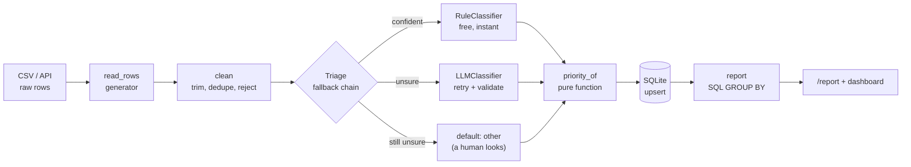
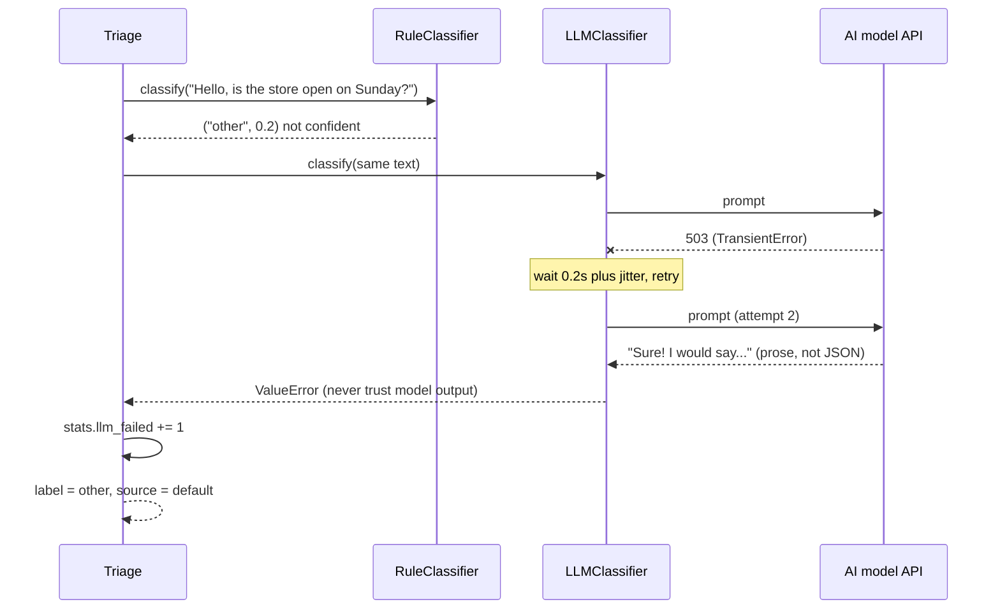
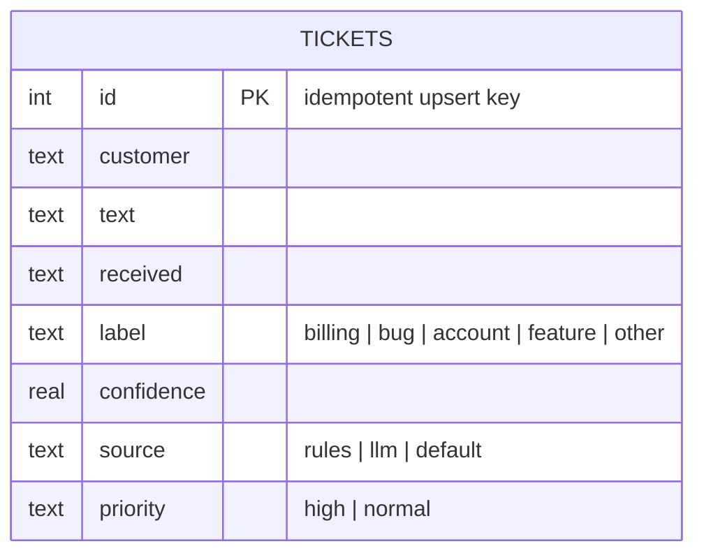

# Blueprint 2 — Ticket Triage Pipeline (data + AI)

> **Data / AI back-end.** The pattern behind spam filters, support-desk routing, invoice processing, content moderation and "LLM in the middle of a business process": messy input in, clean decisions out, **and it never falls over**.

**Stack:** Python 3.11 · `csv` · `dataclasses` · generators · `sqlite3` · `typing.Protocol` · (optional) FastAPI · an AI model behind an adapter
**Files:** `pipeline.py` (~200 lines) · `demo.py` (runs it on a deliberately messy file with a deliberately flaky "AI")
**Prerequisites:** Day 16 (CSV/JSON), 17 (errors), 22 (generators, decorators), 28 (SQL). The same shape scales to pandas/Airflow later.

---

## 1. What problem is this solving?

A company receives 5,000 support tickets a day. Humans should only read the ones that need a human. So:

1. **Ingest** a CSV export (duplicated rows, empty text, a broken id, stray spaces).
2. **Classify** each ticket: billing / bug / account / feature / other.
3. **Prioritise** (someone charged twice should not wait behind a feature request).
4. **Store** the result so a dashboard can show it.
5. **Never fail the whole batch** because one ticket or one API call went wrong.

The interesting part is step 2. An AI model is slow, costs money and sometimes lies. So the design is: **cheap and certain first, expensive and clever only when needed, safe default always.**

## 2. The big picture



## 3. The fallback chain (the idea worth stealing)



Three different failure types, three different reactions:

| Failure | Retry? | Why |
|---|---|---|
| timeout / 429 / 503 (`TransientError`) | **yes**, with backoff | the next try may succeed |
| model answers in prose or invents a label (`ValueError`) | **no** | retrying the same prompt rarely fixes it; fall back |
| anything else | no, count it, fall back | one bad ticket must not stop 4,999 good ones |

## 4. Data model



`source` + `confidence` are **explainability columns**. When someone asks "why was this ticket ignored?" you can answer in one SQL query. Always store *who decided*, not only *what was decided*.

## 5. Each stage in Python

### 5.1 Generators keep memory flat

```python
def read_rows(csv_text):
    yield from csv.DictReader(io.StringIO(csv_text))

def clean(rows, stats):
    for row in rows:
        ...
        yield Ticket(...)

stored = store(db, (triage.label(t) for t in clean(read_rows(csv_text), stats)))
```

Rows flow through **one at a time**. A 5-million-row file uses the same memory as a 5-row file, because nothing builds a giant list.

### 5.2 `Protocol`: a strategy without inheritance

```python
class Classifier(Protocol):
    name: str
    def classify(self, text: str) -> tuple[str, float]: ...
```

Any object with a `name` and a `classify` method qualifies. Adding `KeywordClassifier`, `LocalModelClassifier` or `FakeClassifier` (for tests) needs no base class and no changes to `Triage`.

### 5.3 A decorator that adds retries

```python
def retry(times=3, base=0.2, sleep=time.sleep):
    def decorate(fn):
        @functools.wraps(fn)
        def wrapper(*args, **kwargs):
            for attempt in range(1, times + 1):
                try:
                    return fn(*args, **kwargs)
                except TransientError:
                    if attempt == times:
                        raise
                    sleep(base * 2 ** (attempt - 1) + random.random() * base)
        return wrapper
    return decorate
```

`2 ** (attempt - 1)` doubles the wait (0.2s, 0.4s, 0.8s) so a struggling API gets room to recover; `random()` adds **jitter** so 1,000 clients don't all retry at the same instant. `sleep` is a parameter so tests pass `lambda s: None` and run instantly.

### 5.4 Idempotent storage

```python
INSERT INTO tickets VALUES(?,?,?,?,?,?,?,?)
ON CONFLICT(id) DO UPDATE SET label=excluded.label, ...
```

Run the same file twice, or crash half-way and re-run: the table ends up identical. **A job you can safely re-run is a job you can sleep through.**

### 5.5 A pure function for business rules

```python
def priority_of(t):
    urgent = re.search(r"urgent|asap|twice|locked out|charged", t.text, re.I)
    return "high" if urgent or ... else "normal"
```

No database, no network, no clock: same input always gives the same output. This is the easiest code in the system to test, so put your business rules here.

## 6. Where Python does the work

| Python feature | Where | Course day |
|---|---|---|
| `csv.DictReader`, `io.StringIO` | reading the export | 16 |
| `@dataclass` | `Ticket`: typed record without boilerplate | 19–20 |
| generators, `yield from` | pipeline stages | 22 |
| decorators, `functools.wraps`, closures | `retry` | 22 |
| `re` (regular expressions) | cleaning + rule classifier | 23 |
| `typing.Protocol`, type hints | the classifier contract | 23 |
| `collections.Counter` | `stats` that every stage can bump | 10, 18 |
| `try / except` with specific classes | `TransientError` vs `ValueError` | 17 |
| `json.loads` | parsing and validating the model's answer | 13, 16 |
| `sqlite3`, `executemany`, `ON CONFLICT` | storage + report | 28 |
| first-class functions | `ai` and `sleep` are passed in as arguments | 11–12 |
| `for ... else` | "no classifier was confident" branch | 6 |

## 7. The patterns, and why each one is here

| Pattern | In this code | Payoff |
|---|---|---|
| **Pipeline of generators** | `read_rows → clean → label → store` | constant memory, each stage testable alone |
| **Strategy (Protocol)** | `Classifier` | swap or add classifiers freely |
| **Adapter** | `LLMClassifier` wraps any `client(prompt) -> str` | vendor lock-in lives in one small class |
| **Fallback chain** | `Triage.label` | cheapest-first, never crashes |
| **Retry + backoff + jitter** | `@retry` | survives flaky networks politely |
| **Never trust model output** | validate label ∈ `LABELS` | LLM output is *user input* |
| **Idempotent upsert** | `ON CONFLICT DO UPDATE` | safe re-runs |
| **Dependency injection** | `ai=`, `sleep=` parameters | fake AI and instant tests |
| **Explainability columns** | `source`, `confidence` | auditability |
| **Functional core** | `priority_of` | rules you can unit-test in one line |

## 8. What breaks in production (and the fix)

| Problem | Fix |
|---|---|
| The AI bill explodes | rules first (already), cache answers by text hash, batch prompts, cap calls per run (`stats["llm_calls"]` already counts them) |
| 5 million rows do not fit one run | read in chunks, `executemany` per chunk, checkpoint the last id |
| Model quality silently drifts | keep a small **golden set** of labelled tickets; run it nightly and alert if accuracy drops |
| Private data goes to a third party | redact emails and card numbers in `clean` *before* the AI sees the text |
| Two runs at once | a lock (file or DB), or a queue (Celery / RQ / cloud tasks) so only one worker runs a job |
| You cannot explain a wrong label | store `source`, `confidence`, model name and prompt version (already half done) |

## 9. Run it

```text
python demo.py          # narrated run on a messy file with a flaky fake AI
```

The demo prints: what was rejected and why, which classifier decided each ticket, how many AI calls were retried, the report, and proof that re-running changes nothing.

Optional web layer (needs `fastapi httpx uvicorn`). Save this as `serve.py` next to `pipeline.py`, then run `uvicorn serve:app`:

```python
import sqlite3
from pipeline import build_app

app = build_app(sqlite3.connect("tickets.db", check_same_thread=False))
```

`build_app(db)` takes the connection as an argument on purpose: that is dependency injection, and it is why the demo can call it with an in-memory database. Then `POST` a CSV to `/tickets/ingest` and open `/` for the report.

## 10. Build it yourself — milestones

1. **Add a `KeywordClassifier`** that reads its words from a JSON file. Put it before `RuleClassifier` in the chain.
2. **Cache the AI.** Wrap `LLMClassifier.classify` in a dictionary keyed by `hashlib.sha1(text)`; show the call count drop on the second run.
3. **Replace `csv` with pandas** in `read_rows` / `report` (`read_csv`, `groupby`). Keep the stage boundaries identical.
4. **Redact personal data** with two regexes (emails, 16-digit numbers) as a new stage between `clean` and `label`.
5. **Add a golden-set test** in pytest: 10 labelled tickets, assert rule-only accuracy ≥ 70 %.
6. **Real model.** Write `def client(prompt): ...` using your provider's SDK; pass it as `ai=`. Nothing else in the file changes.
