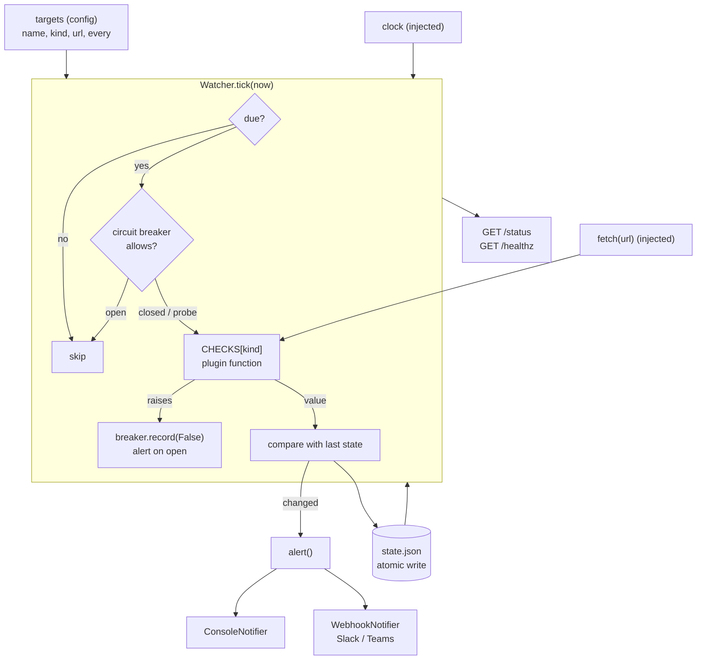
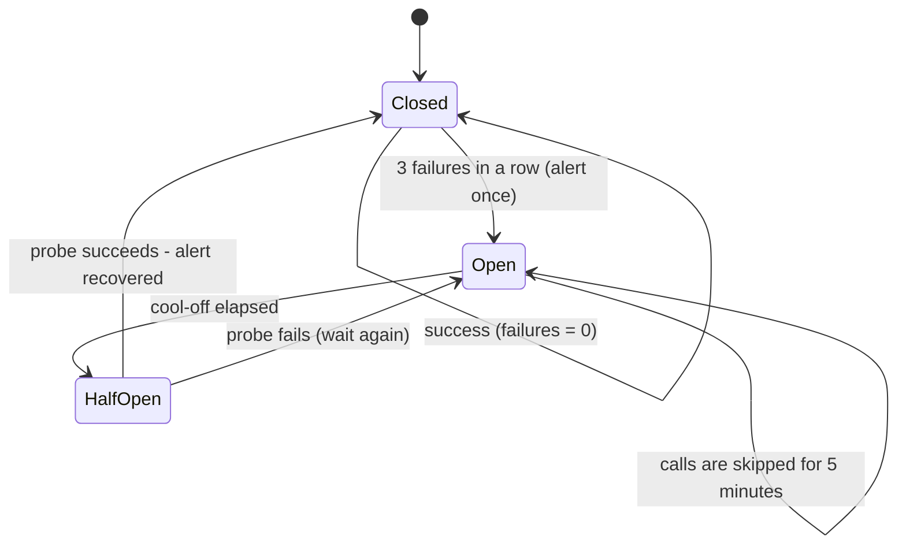

# Blueprint 3 — Site & Price Watcher (automation + monitoring)

> **Automation back-end.** The pattern behind uptime monitors, price trackers, compliance checkers, scheduled reports and "tell me when X changes" bots: run small jobs on a schedule, remember what you saw, speak up **only when something changed**, and survive a bad day on the internet.

**Stack:** Python 3.11 · `dataclasses` · `re` · `hashlib` · `json` · `pathlib` · `logging` · (optional) FastAPI status page · requests/Slack-style webhook behind an interface
**Files:** `watcher.py` (~200 lines) · `demo.py` (40 simulated minutes in a few milliseconds)
**Prerequisites:** Day 15 (files), 17 (errors, logging), 19 (classes), 22 (decorators), 23 (regex), 27 (HTTP). Pairs well with Blueprint 2.

---

## 1. What problem is this solving?

You want to know when a laptop drops 5 % in price, when a changelog page changes, and whether your payment API is down. Doing it badly is easy: a `while True` loop that hits every site every second and e-mails you 400 times during an outage. Doing it well means:

1. **Schedule** — each target has its own rhythm (every 2 min vs every 10 min).
2. **Plugins** — a new kind of check should not require editing the engine.
3. **Memory** — compare with the *previous* value, and remember it across restarts.
4. **Alert on transitions** — "went down", "recovered", "price dropped", not "still down" 400 times.
5. **Politeness and resilience** — stop calling a dead service (circuit breaker); never corrupt your own state file.
6. **Testability** — the clock and the internet are *parameters*, so a test can live 40 minutes in 5 ms.

## 2. The big picture



## 3. The circuit breaker (the idea worth stealing)



During the simulated outage in the demo, the watcher made **3 failing calls, 1 failing probe and 1 successful probe**, instead of hammering the API every two minutes for 16 minutes. The owner got **two** messages, not twenty.

## 4. Each idea in Python

### 4.1 Plugin registry with a decorator

```python
CHECKS = {}

def check(kind):
    def register(fn):
        CHECKS[kind] = fn
        return fn
    return register

@check("price")
def price_check(target, fetch):
    html = fetch(target["url"])
    m = re.search(target["pattern"], html)
    if not m:
        raise ValueError("price pattern not found: the site layout probably changed")
    return float(m.group(1).replace(",", ""))
```

A new check type is one decorated function. The engine only ever says `CHECKS[t["kind"]](t, fetch)`. The same trick powers Flask routes, pytest fixtures and Django signals.

### 4.2 Time and network are parameters

```python
w = Watcher(TARGETS, fetch=net.fetch, notifiers=[...], state_path=...)
w.tick(now=600.0)           # "it is now 10 minutes in"
```

Real code passes `time.time()` and a function wrapping `requests.get`. Tests pass a fake clock and a fake website. **If you cannot test it without waiting or without internet, the design is leaking.**

### 4.3 Alert on transitions

```python
if old is None or old == value:      # first sighting, or unchanged: stay quiet
    return
...
if br.state == "open" and not was_open:
    self.alert(f"{name} is failing", ...)
```

Compare *current* with *previous* and speak only when they differ. This single habit separates useful alerts from the ones everybody mutes.

### 4.4 Atomic file writes

```python
fd, tmp = tempfile.mkstemp(dir=path.parent, suffix=".tmp")
with os.fdopen(fd, "w", encoding="utf-8") as fh:
    json.dump(state, fh)
os.replace(tmp, path)               # atomic swap
```

If the machine loses power mid-write, the *old* file is still intact. Writing straight into `state.json` risks a half-written, unreadable file and a watcher that forgets everything.

**A real-world wrinkle (found while testing this very blueprint):** on **Windows**, `os.replace` can raise `PermissionError` for a few milliseconds when an antivirus scanner or the search indexer touches the file. The real code wraps the swap in a short retry loop (8 tries, growing 20 ms sleeps). Linux never needs it; production code that must run on both does.

### 4.5 One bad notifier must not break the rest

```python
for n in self.notifiers:
    try:
        n.send(title, body)
    except Exception:
        log.exception("notifier %s failed", type(n).__name__)
```

Isolating failures inside loops is what keeps a 3 a.m. system boring.

## 5. Where Python does the work

| Python feature | Where | Course day |
|---|---|---|
| decorator that registers a function | `@check("price")` | 22 |
| dict of functions (functions are objects) | `CHECKS[kind](...)` | 11–12 |
| `@dataclass`, `field(default_factory=...)` | `Breaker`, `Watcher` | 19–20 |
| `typing.Protocol` | `Notifier` | 23 |
| `re.search` + groups | pulling `1,299.00` out of HTML | 23 |
| `hashlib.sha256` | page fingerprint | 18 |
| `pathlib.Path`, `json`, `tempfile`, `os.replace` | state file | 15–16 |
| `try / except / continue` in loops | resilient `tick` | 17 |
| `logging.exception` | records the traceback without crashing | 17 |
| `@property` | `Breaker.state` | 19–20 |
| first-class functions as dependencies | `fetch`, `post`, `sleep`, `clock` | 11–12 |
| f-strings with format specs | `{drop:.0f}`, `{old:g}` | 4 |

## 6. The patterns, and why each one is here

| Pattern | In this code | Payoff |
|---|---|---|
| **Plugin registry** | `@check` + `CHECKS` | extend without editing the engine |
| **Scheduler tick** | `Watcher.tick(now)` + `due` | simple, deterministic, testable |
| **Circuit breaker** | `Breaker` | stops hammering failing services |
| **Observer / notifier interface** | `Notifier` Protocol | add Slack, e-mail, SMS freely |
| **Alert on state change** | `compare` | no alert fatigue |
| **Atomic persistence** | `save_state` | crash-safe memory |
| **Injected clock + network** | `fetch`, `now` | millisecond tests |
| **Fail-soft loops** | `try/except` per target and per notifier | one problem never stops the rest |
| **Fail loud on layout change** | `ValueError` when the regex misses | wrong data is worse than no data |

## 7. What breaks in production (and the fix)

| Problem | Fix |
|---|---|
| Sites block you | respect `robots.txt`, set a clear `User-Agent`, add random jitter to `every`, honour `Retry-After` |
| A layout change gives a wrong price (`$1` from a coupon) | tighten the regex, validate ranges (price within 50–150 % of last), alert on parse failure (already done) |
| Two copies of the watcher run | a lock file, or run it as one scheduled job in cron / Windows Task Scheduler / a cloud scheduler |
| State file grows or is shared by many workers | move to SQLite or Redis; same `load_state / save_state` interface |
| You need sub-second precision or thousands of targets | `asyncio` + `httpx.AsyncClient`, a work queue, a real scheduler (APScheduler / Celery beat) |
| Secrets (webhook URLs) in code | environment variables or a secrets manager; never commit them |
| Silent death | an external "dead-man's switch" (healthchecks.io style): the watcher pings it every run; no ping means someone pages you |

## 8. Run it

```text
python demo.py          # 40 simulated minutes; prints alerts as they happen, then the dashboard
```

To run it for real, replace the fake with the real internet and the real clock:

```python
import time, requests
from watcher import Watcher, ConsoleNotifier, WebhookNotifier, run_forever

fetch = lambda url: requests.get(url, timeout=10, headers={"User-Agent": "my-watcher/1.0"}).text
w = Watcher(TARGETS, fetch, [ConsoleNotifier(), WebhookNotifier(SLACK_URL, requests.post)], Path("state.json"))
run_forever(w, sleep=time.sleep, clock=time.time)
```

## 9. Build it yourself — milestones

1. **Add `kind: "keyword"`** — alert when a word (e.g. "in stock") appears on the page. One decorated function.
2. **Add an e-mail notifier** with `smtplib`, reading credentials from environment variables.
3. **Add a rolling minimum.** Alert only when the price is the lowest seen in 30 days (store the minimum in state).
4. **Add `/status` to your phone.** Run `build_app(w)` with uvicorn in a thread beside `run_forever`.
5. **Write pytest tests** with a fake clock: breaker opens after 3 failures, probes after the cool-off, closes on success, and alerts exactly twice.
6. **Make it async.** Turn `fetch` into `async def`, run all due targets with `asyncio.gather`, keep the breaker logic unchanged.
