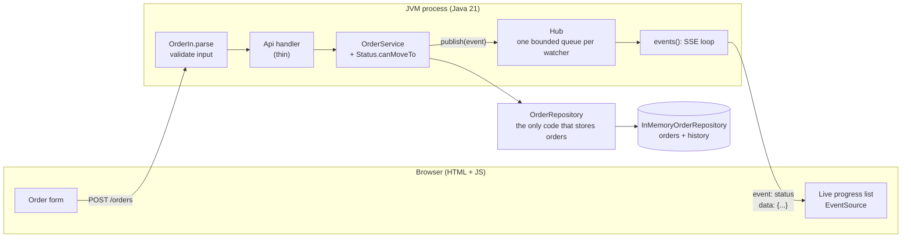
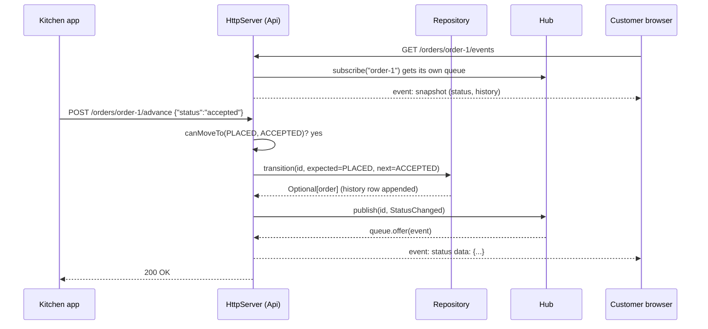
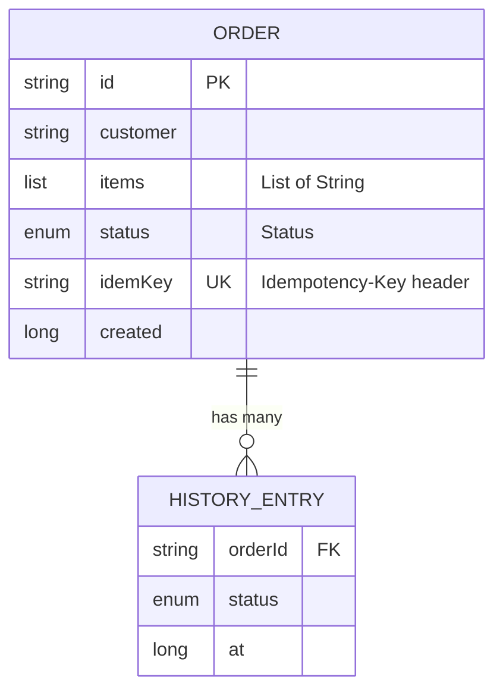
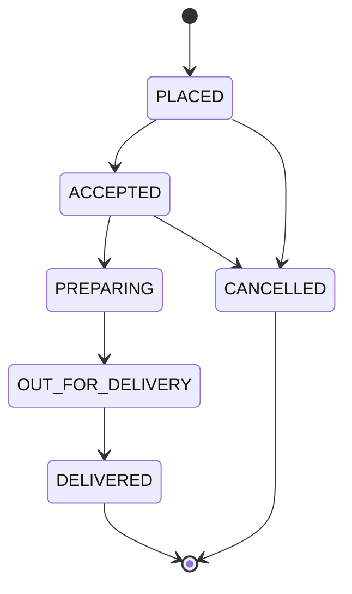

# Blueprint 1 — Live Order Tracker (real-time backend), Java edition
> **Real-time full-stack backend.** The pattern behind food-delivery, ride-hailing, parcel tracking and ticket-booking apps: one person changes something, everyone watching sees it *instantly*. This is the Java 21 twin of the Python blueprint: same problem, same state machine, same API shape, JDK only. The live push uses **Server-Sent Events** instead of WebSockets (see section 10).

**Stack:** Java 21 · `com.sun.net.httpserver.HttpServer` · `java.net.http.HttpClient` · `record` · `sealed interface` · `enum` · `Optional` · `ConcurrentHashMap` · `BlockingQueue` · Server-Sent Events · an in-memory repository behind an interface · plain HTML/JS front end in a text block
**Files:** `Server.java` (the whole system: domain, repository, hub, service, HTTP layer, app factory) · `Json.java` (a tiny JSON reader/writer, because the JDK has none) · `Demo.java` (starts the real server on a free port, talks to it with a real client, narrates)
**Prerequisites:** Day 12 (lambdas), 13 (records), 17 (exceptions), 19-20 (classes, enums, sealed), 22 (Optional), 27 (HTTP + JSON), 30 (REST API). Day 28 (JDBC) matters for the "swap the store" milestone.

---

## 1. What problem is this solving?
A customer places a pizza order. The kitchen accepts it, a driver picks it up, the customer watches a progress bar move. The hard parts are **not** the HTML. They are:
1. **Correctness**: an order must never jump from *delivered* back to *preparing*.
2. **Safe retries**: phones lose signal; the app resends "place order". It must not create two pizzas.
3. **Fan-out**: one status change must reach every open browser tab, quickly, without the server waiting on slow clients.
4. **History**: support will ask "when was it accepted?" (an audit trail).

## 2. The big picture

**Read it left to right:** input is validated, a thin handler asks the service, the service asks the state machine for permission, the repository stores the change, the hub fans the event out, and each open SSE response writes it to a browser.

## 3. One request, step by step

The order of the first two steps matters: **subscribe, then read the snapshot.** Done the other way round, a change that lands between the read and the subscribe is lost forever.

## 4. Data model

History is **append-only**: you never edit the past, you add an entry. That one decision gives you an audit trail, debugging and analytics for free. In Java the "tables" are `HashMap<String, Order>` and `HashMap<String, List<HistoryEntry>>` inside `InMemoryOrderRepository`, and a row is an immutable `record`.

## 5. The state machine (the most valuable 12 lines)

In Java it is an `enum` whose `switch` expression must cover every constant:
```java
enum Status {
    PLACED, ACCEPTED, PREPARING, OUT_FOR_DELIVERY, DELIVERED, CANCELLED;

    Set<Status> next() {
        return switch (this) {
            case PLACED -> EnumSet.of(ACCEPTED, CANCELLED);
            case ACCEPTED -> EnumSet.of(PREPARING, CANCELLED);
            case PREPARING -> EnumSet.of(OUT_FOR_DELIVERY);
            case OUT_FOR_DELIVERY -> EnumSet.of(DELIVERED);
            case DELIVERED, CANCELLED -> EnumSet.noneOf(Status.class);
        };
    }
    boolean canMoveTo(Status target) { return next().contains(target); }
}
```
Add a seventh constant and the file **stops compiling** until you say where it may go. The Python version is a dictionary, and a forgotten entry becomes a `KeyError` at 2 a.m. Why a table and not `if/else`? Because a table can be read, tested and drawn: the diagram above was almost copy-pasted from it.

## 6. API contract
| Method + path | Purpose | Success | Errors |
|---|---|---|---|
| `POST /orders` (+ `Idempotency-Key`) | place an order | `201` (or `200` if the key was seen) | `422` bad body, `400` malformed JSON, `413` too large |
| `GET /orders/{id}` | order + history | `200` | `404` |
| `GET /orders/{id}/history` | the audit trail only | `200` | `404` |
| `POST /orders/{id}/advance` | kitchen / driver moves it; body `{"status": "preparing"}` optional (none = next happy-path step) | `200` | `404`, `409` illegal move, `422` unknown status |
| `GET /orders/{id}/events` | live updates (SSE) | snapshot, then events, then the stream closes | `404` |
| `GET /` | the front-end page | HTML | |

Use the right status code. `409 Conflict` means "your request is valid, but not allowed *right now*". Clients (and humans reading logs) react to it differently than to `422`. A wrong HTTP verb gets `405`.

## 7. Where Java does the work
| Java feature | Where it shows up | Course day |
|---|---|---|
| `enum` with a `switch` expression | `Status`: typo-proof constants and the transition table | 5, 20 |
| `EnumSet`, `Map`, `HashMap` | legal next states, the repository tables | 9-10 |
| `record` (compact constructor) | `Order`, `HistoryEntry`, `OrderIn`, `Created`: immutable carriers, `List.copyOf` defends them | 13, 20 |
| `sealed interface` + pattern `switch` | `Event` and `Outcome`: the compiler checks every case is handled | 20 |
| `Optional` (`or`, `orElseThrow`) | "found / not found", the optional target status | 22 |
| interface + implementation | `OrderRepository` / `InMemoryOrderRepository` | 19-20 |
| `synchronized` block | the repository's check-then-write is one atomic step | 20, 25 |
| `ConcurrentHashMap.compute` | the hub's watcher table, safe without a global lock | 25 |
| `BlockingQueue` (`ArrayBlockingQueue`) | one bounded mailbox per watcher; `offer` never blocks | 25 |
| `AutoCloseable` + try-with-resources | `Hub.Subscription` and `App` always clean up | 17 |
| custom exceptions + specific `catch` | `HttpError`, `ValidationException` become 4xx responses | 17 |
| lambdas, `Supplier`, `LongSupplier` | injected id generator and clock | 12, 22 |
| text block `"""` | the whole front-end page | 4 |
| `HttpServer` + `HttpExchange` | routing, headers, status codes, chunked streaming | 27, 30 |
| `HttpClient` (`ofLines`) | the demo's customer reading the SSE stream | 27 |
| executors, `CountDownLatch`, `Future` | the 8-simultaneous-taps test | 25, 29 |
| hand-written JSON reader/writer | `Json.parse` / `Json.write` | 16, 27 |

## 8. The patterns, and why each one is here
| Pattern | In this code | Payoff |
|---|---|---|
| **App factory** | `Server.buildApp(repo, hub, port)` | every test and the demo get a fresh server on a free port (port `0`) |
| **Dependency injection** | `OrderService(repo, hub)`, `InMemoryOrderRepository(ids, clock)` | swap the store, the id generator or the clock without touching handlers |
| **Repository** | `OrderRepository` | storage lives in one class; JDBC later = one new class |
| **State machine** | `Status.next()` + `canMoveTo` | impossible states cannot happen |
| **Compare-and-set** | `transition(id, expected, next)` | two simultaneous taps: exactly one wins, the rest get `409` |
| **Idempotency key** | `Idempotency-Key` header + `byKey` map | retries are safe |
| **Pub/Sub (observer)** | `Hub.publish / subscribe` | handlers do not know who is listening |
| **Bounded queue, drop on full** | `ArrayBlockingQueue` + `offer` | a stuck phone cannot stall the publisher |
| **Sealed results** | `Outcome.Ok / NotFound / Illegal` | the service returns data, the HTTP layer picks the status code |
| **Validation at the edge** | `OrderIn.parse` | the core never sees garbage |
| **Append-only history** | `HistoryEntry` list | audit + analytics |
Full explanations and reusable snippets: **[Patterns catalog](#/blueprints/patterns)**.

## 9. What breaks in production (and the fix)
| Problem | Why it happens | Fix |
|---|---|---|
| Server leaks threads over days | a closed browser tab is only noticed on the next write | the keep-alive comment (`: keepalive`) forces a write every 15 s, so a dead socket throws `IOException` and `try-with-resources` unsubscribes; add a hard cap on watchers per order |
| One thread per open stream | `newCachedThreadPool` | fine for thousands; beyond that use `Executors.newVirtualThreadPerTaskExecutor()` (Java 21) |
| Two kitchen taps at once both succeed | check-then-write race | already fixed: `transition` compares the expected status inside one lock. With JDBC use `UPDATE ... WHERE id=? AND status=?` and check the row count |
| Only one server process works | the `Hub` lives in memory, so a second process never hears the event | put Redis pub/sub (or Postgres `LISTEN/NOTIFY`) behind the same `publish / subscribe` interface |
| Orders vanish on restart | the store is a `HashMap` | implement `OrderRepository` with JDBC (Day 28); the service and handlers stay as they are |
| A slow phone stalls everyone | unbounded queues | bounded queue + drop on full (already there). Better: on a drop, send the client a fresh snapshot |
| A reconnect misses events | SSE has no memory by itself | send an `id:` per event and honour `Last-Event-ID`, or simply send a snapshot on every connect (already there) |
| Anyone can move any order | no authentication | check a token in the handler, give kitchen and customer different roles |
| Huge request bodies | unbounded `readAllBytes` | already capped at 64 KB (`413`) |
| The `HttpServer` is not a framework | no TLS, no HTTP/2, no routing DSL | in production put a reverse proxy in front, or move to Spring Boot / Javalin / Helidon with the same layers |

## 10. Run it
```text
cd java\blueprints\01_live_order_tracker
javac -d out *.java
java -cp out Demo          # narrated, own server on a free port, a few seconds
java -cp out Server        # the real thing on http://127.0.0.1:8000/
```
Or press **Run** on `Demo.java` in the portal (it compiles all `.java` files in this folder and runs `Demo`). The demo needs no network beyond loopback, prints no ports, timestamps or random ids (ids are `order-1`, `order-2`; the clock is fake), and leaves no thread, file or port behind. The output is the same on every run.

Open the real page in **two browser windows**, place an order in one, and press the status buttons in the other: both lists update.

The demo prints: the idempotent retry, validation errors, a live SSE conversation, refused illegal moves, the 8-simultaneous-taps race, the audit trail, the dropped-events counter of a slow watcher, and a clean shutdown.

## 11. Differences from the Python version
| Python | Java | Why it differs |
|---|---|---|
| FastAPI + pydantic | `HttpServer` + `OrderIn.parse` | the JDK has no framework; validation is a small hand-written record |
| WebSocket `/ws/orders/{id}` | Server-Sent Events `/events` | the JDK has a WebSocket **client** only. SSE is one-way (server to browser), which is all a tracker needs, and the browser `EventSource` reconnects by itself |
| SQLite (`sqlite3`) | in-memory maps behind an interface | one file, no jar. JDBC + SQLite is milestone 5 |
| `async def`, `asyncio.Queue` | threads + `ArrayBlockingQueue` | blocking style, simple to read; virtual threads make it scale |
| `class X(str, Enum)` + dict of sets | `enum` + `switch` expression | the compiler checks the table is complete |
| `Depends(repo)` | constructor arguments | plain dependency injection, no container |
| `POST /orders/{id}/status` | `POST /orders/{id}/advance` | an empty body means "next step of the happy path" |
| `json.dumps` / `loads` | `Json.write` / `Json.parse` | no JSON in the JDK; use Jackson in real code |

## 12. Build it yourself — milestones
1. **Add a role.** Customers may only `cancel`; the kitchen may do everything else. (Hint: an `X-Role` header first, real auth later. Return `403`.)
2. **Add an ETA.** Put `eta_minutes` per `Status` in the enum (a constructor argument) and add it to every event.
3. **Honour `Last-Event-ID`.** Number events per order, keep the last 50 in the hub, and replay what a reconnecting client missed.
4. **Write 6 JUnit 5 tests** (Day 24) that call `Server.buildApp(...)` with port `0`: happy path, idempotent retry, illegal move, unknown order, validation error, the SSE client receives the push.
5. **Swap the store.** Write `JdbcOrderRepository` (Day 28, SQLite) with `UPDATE ... WHERE id=? AND status=?` for the compare-and-set. If you touched anything but the repository and `main`, the design leaked.
6. **Scale the watchers.** Replace the cached thread pool with a virtual-thread executor, open 2,000 streams from the demo, and show that memory and the watcher count stay flat after they close.
