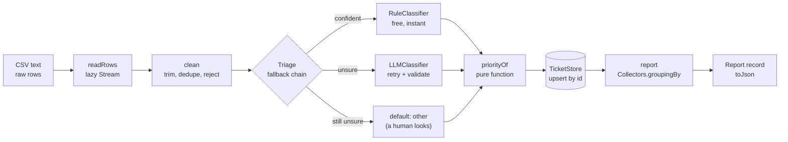
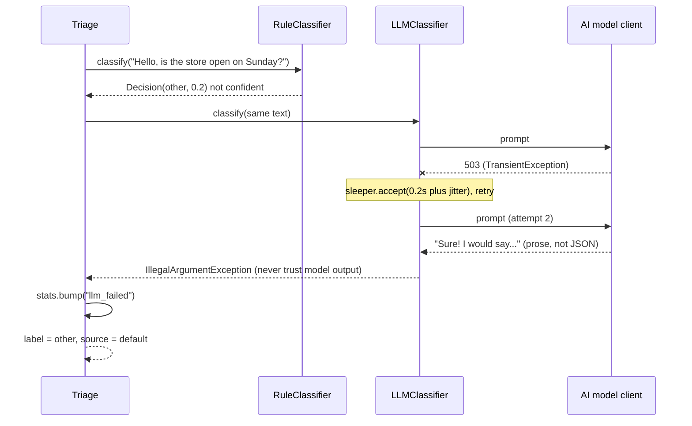
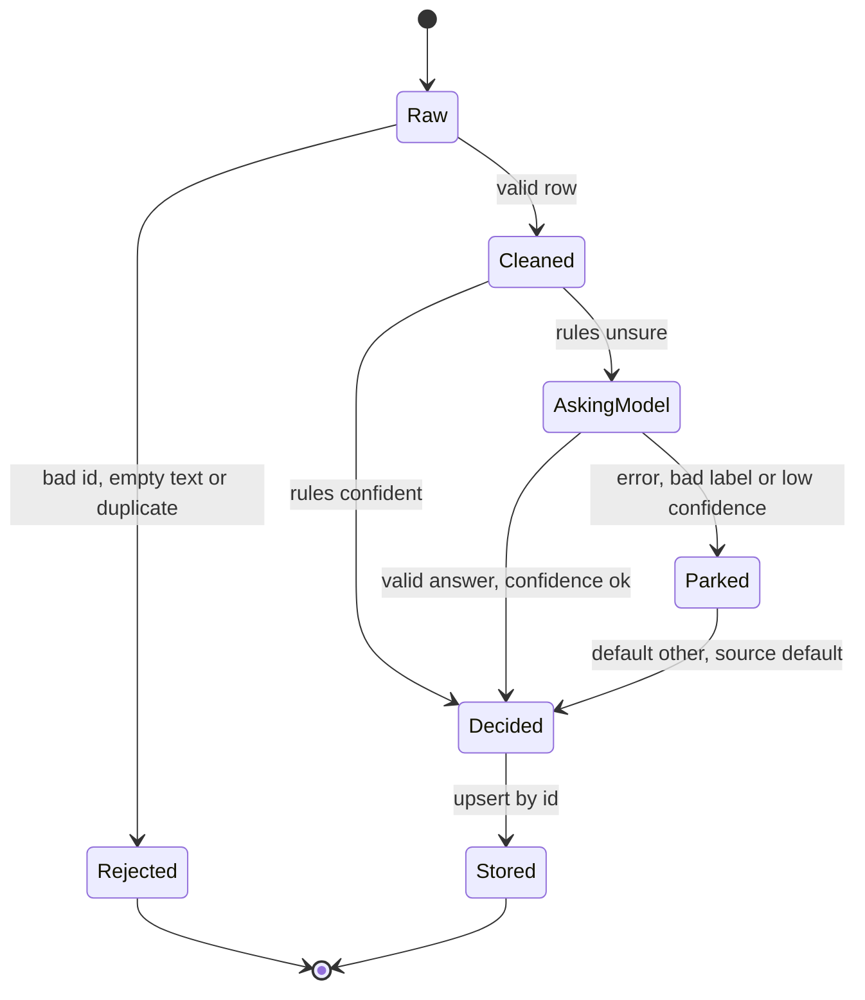
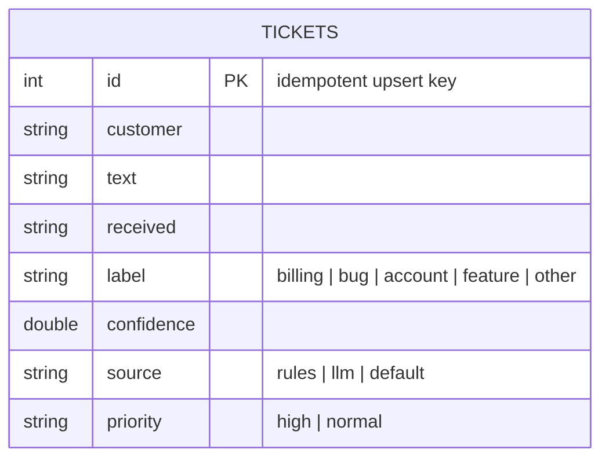

# Blueprint 2 — Ticket Triage Pipeline (data + AI), Java edition

> **Data / AI back-end.** The pattern behind spam filters, support-desk routing, invoice processing, content moderation and "LLM in the middle of a business process": messy input in, clean decisions out, **and it never falls over**. This is the Java 21 twin of the Python blueprint: same problem, same demo data, same decisions.

**Stack:** Java 21 · `Stream` · `record` · `sealed interface` · `Optional` · `Function` / `Supplier` / `DoubleConsumer` · `Pattern` · `Collectors` · an in-memory store · an AI model behind an adapter
**Files:** `Pipeline.java` (~300 lines, everything in one file as nested types) · `Demo.java` (runs it on a deliberately messy file with a deliberately flaky "AI")
**Prerequisites:** Day 12 (lambdas, streams), 16 (CSV), 17 (exceptions), 20 (records, sealed), 22 (Optional, functional interfaces), 25 (Collectors). The same shape scales to Spring Batch / Kafka consumers later.

---

## 1. What problem is this solving?

A company receives 5,000 support tickets a day. Humans should only read the ones that need a human. So:

1. **Ingest** a CSV export (duplicated rows, empty text, a broken id, stray spaces).
2. **Classify** each ticket: billing / bug / account / feature / other.
3. **Prioritise** (someone charged twice should not wait behind a feature request).
4. **Store** the result so a dashboard can show it.
5. **Never fail the whole batch** because one ticket or one API call went wrong.

The interesting part is step 2. An AI model is slow, costs money and sometimes lies. So the design is: **cheap and certain first, expensive and clever only when needed, safe default always.**

## 2. The big picture



## 3. The fallback chain (the idea worth stealing)



Three different failure types, three different reactions:

| Failure | Retry? | Why |
|---|---|---|
| timeout / 429 / 503 (`TransientException`) | **yes**, with backoff | the next try may succeed |
| model answers in prose or invents a label (`IllegalArgumentException`) | **no** | retrying the same prompt rarely fixes it; fall back |
| anything else (`Exception`) | no, count it, fall back | one bad ticket must not stop 4,999 good ones |

### The life of one ticket



## 4. Data model



In Java the "table" is `TreeMap<Integer, Ticket>` inside `TicketStore`, and a row is an immutable `record Ticket(...)`. `source` + `confidence` are **explainability columns**: when someone asks "why was this ticket ignored?" you can answer from the data. Always store *who decided*, not only *what was decided*.

## 5. Each stage in Java

### 5.1 Lazy streams keep memory flat

```java
public static Stream<Ticket> clean(Stream<Map<String, String>> rows, Stats stats) {
    Set<Integer> seen = new HashSet<>();
    return rows.map(row -> cleanOne(row, stats, seen)).flatMap(Optional::stream);
}

int stored = store.upsert(clean(readRows(csvText), stats).map(triage::label));
```

A `Stream` does **nothing** until a terminal operation (`forEach`, `count`, `toList`) pulls on it. Rows then flow through **one at a time**: a 5-million-row file uses the same memory as a 5-row file, because no stage builds a list. The demo proves it: "stream built, rows read so far: 0".

`cleanOne` returns an `Optional<Ticket>`: empty means "rejected", and `flatMap(Optional::stream)` drops the empties. That is the Java spelling of Python's `continue` inside a generator.

### 5.2 `sealed interface`: a strategy the compiler can check

```java
public sealed interface Classifier permits RuleClassifier, LLMClassifier {
    String name();
    Decision classify(String text);
}

public static String describe(Classifier c) {
    return switch (c) {
        case RuleClassifier r -> "rules (free, instant, explainable)";
        case LLMClassifier l -> "llm (slow, costs money, retried, validated)";
    };
}
```

`sealed` lists every allowed classifier. A `switch` over it needs **no `default`**: add a third classifier and every switch stops compiling until you handle it. (Python's `Protocol` is open: anything with the right methods fits. See the differences section.)

### 5.3 Retry with an injected sleeper and a seeded `Random`

```java
public static <T> T retry(int times, double baseSeconds, DoubleConsumer sleeper, Random rng, Supplier<T> call) {
    for (int attempt = 1; ; attempt++) {
        try {
            return call.get();
        } catch (TransientException e) {
            if (attempt >= times) throw e;
            sleeper.accept(baseSeconds * Math.pow(2, attempt - 1) + rng.nextDouble() * baseSeconds);
        }
    }
}
```

`Math.pow(2, attempt - 1)` doubles the wait (0.2s, 0.4s, 0.8s) so a struggling API gets room to recover; `nextDouble()` adds **jitter** so 1,000 clients don't retry at the same instant. `sleeper` is a parameter: production passes `Pipeline.REAL_SLEEPER`, the demo passes `waits::add` (records) or `s -> { }` (nothing). `new Random(42)` always yields the same numbers, so even the "random" waits are the same on every run: `[0.35, 0.34]`.

### 5.4 Never trust the model: a record that validates itself

```java
public record Decision(String label, double confidence) {
    public Decision {                                   // compact constructor
        if (label == null || !LABELS.contains(label))  throw new IllegalArgumentException("unknown label '" + label + "'");
        if (Double.isNaN(confidence) || confidence < 0.0 || confidence > 1.0) throw new IllegalArgumentException("confidence out of range: " + confidence);
    }
}
```

The adapter builds a `Decision` straight from the model's reply, so an invented label or a score of `7.5` **cannot exist** past that line. LLM output is user input. (The JDK has no JSON parser, so `LLMClassifier` pulls `label` and `confidence` out with two small regexes; in production you would add Jackson or Gson.)

### 5.5 Idempotent storage

```java
rows.merge(t.id(), t, (old, neu) -> new Ticket(old.id(), old.customer(), old.text(), old.received(),
                                                neu.label(), neu.confidence(), neu.source(), neu.priority()));
```

`Map.merge` is the in-memory `INSERT ... ON CONFLICT(id) DO UPDATE`: a new id inserts, a known id updates only the decision columns. Run the same file twice, or crash half-way and re-run: the store ends up identical (the demo checks `before.equals(store.all())`). **A job you can safely re-run is a job you can sleep through.**

### 5.6 A pure function for business rules

```java
public static String priorityOf(Ticket t) {
    boolean urgent = URGENT.matcher(t.text()).find();
    boolean crashingBug = "bug".equals(t.label()) && t.text().toLowerCase(Locale.ROOT).contains("crash");
    return urgent || crashingBug ? "high" : "normal";
}
```

No store, no network, no clock: the same input always gives the same output. It is the easiest code in the system to test, so put your business rules here.

### 5.7 The report with `Collectors`

```java
rows.values().stream().collect(Collectors.groupingBy(Ticket::label, Collectors.counting()))
```

This is the SQL `GROUP BY` of the Python version. The result goes into a `Report` record with a hand-written `toJson()` (the JDK ships no JSON writer).

## 6. Where Java does the work

| Java feature | Where | Course day |
|---|---|---|
| a hand-rolled CSV reader, `Iterator` | `csvRecords`, `readRows` | 16, 22 |
| text blocks `"""`, `String.format`, `Locale.ROOT` | the inline CSV, the demo printout | 4 |
| `Stream`, lambdas, method references (`triage::label`) | stages of the pipeline | 12 |
| laziness and terminal operations | `readRows` / `clean` do nothing until `upsert` pulls | 12, 26 |
| `record` (compact constructor, `equals`) | `Ticket`, `Decision`, `Report`, `Result` | 13, 20 |
| `sealed interface`, pattern-matching `switch` | `Classifier`, `describe` | 5, 20 |
| interfaces and polymorphism | `Classifier` implemented by two classes | 20 |
| `Optional`, `flatMap(Optional::stream)` | `cleanOne` rejects without `null` | 22 |
| `Function`, `Supplier`, `DoubleConsumer` | injected `ai` client, `retry` call, `sleeper` | 12, 22 |
| generics (`<T> T retry(...)`) | the retry helper works for any return type | 22 |
| custom exception + `try/catch` with specific classes | `TransientException` vs `IllegalArgumentException` | 17 |
| `Pattern` / `Matcher` | cleaning, `RuleClassifier`, `priorityOf`, reading the model's JSON | 23 |
| `Map`, `TreeMap`, `LinkedHashMap`, `merge` | `Stats` counter, `TicketStore`, rule table | 10 |
| `Collectors.groupingBy`, `counting`, `joining` | `report()`, `toJson()` | 25 |
| immutability, small methods, constructor injection | `List.copyOf`, one job per method | 19, 23 |
| seeded `java.util.Random` | deterministic jitter in the demo | 18 |

## 7. The patterns, and why each one is here

| Pattern | In this code | Payoff |
|---|---|---|
| **Pipeline of lazy streams** | `readRows -> clean -> label -> upsert` | constant memory, each stage testable alone |
| **Strategy (sealed interface)** | `Classifier` | the compiler lists every strategy; swap or add one in one place |
| **Adapter** | `LLMClassifier` wraps any `Function<String,String>` | vendor lock-in lives in one small class |
| **Fallback chain** | `Triage.label` | cheapest-first, never crashes |
| **Retry + backoff + jitter** | `Pipeline.retry` | survives flaky networks politely |
| **Never trust model output** | `Decision` compact constructor | LLM output is *user input* |
| **Idempotent upsert** | `TicketStore.upsert` with `Map.merge` | safe re-runs |
| **Dependency injection** | `ai`, `sleeper`, `rng` parameters | fake AI, instant and deterministic tests |
| **Explainability columns** | `source`, `confidence` | auditability |
| **Functional core** | `priorityOf` | rules you can unit-test in one line |
| **Repository** | `TicketStore` owns all reads and writes | swap in JDBC later without touching the pipeline |

## 8. What breaks in production (and the fix)

| Problem | Fix |
|---|---|
| The AI bill explodes | rules first (already), cache answers by text hash in a `ConcurrentHashMap`, batch prompts, cap calls per run (`stats.get("llm_calls")` already counts them) |
| 5 million rows do not fit one run | the stream is already lazy; write to the database in batches (`PreparedStatement.addBatch`) and checkpoint the last id |
| Model quality silently drifts | keep a small **golden set** of labelled tickets; run it nightly (JUnit, Day 24) and alert if accuracy drops |
| Private data goes to a third party | redact emails and card numbers in `clean` *before* the AI sees the text |
| Two runs at once | a lock (file or database row), or a queue (Kafka, SQS, a scheduler) so only one worker runs a job |
| You cannot explain a wrong label | store `source`, `confidence`, model name and prompt version (already half done) |
| A hung model call blocks the batch | give `HttpClient` a request timeout and run calls on a bounded executor; a timeout is a `TransientException` |
| A rules-only re-run overwrites better AI labels | `upsert` replaces the decision columns, so a second run **without** the AI would downgrade ticket 5 and 9 to `default`. Keep the better `source`, or re-run with the AI, as the demo does |
| Parallel streams corrupt the state | `clean` keeps a plain `HashSet`; never call `.parallel()` on this pipeline unless you switch to concurrent collections |

## 9. Run it

```text
cd java\blueprints\02_ticket_triage_pipeline
javac -d out *.java
java -cp out Demo
```

Or press **Run** on `Demo.java` in the portal (it compiles all `.java` files in this folder and runs `Demo`). Everything is in the default package, JDK 21 only, no network, no real sleeping: the output is the same on every run and the program ends in well under a second.

The demo prints: the lazy stream proof, what was rejected and why, which classifier decided each ticket, how many AI calls were retried (and the exact backoff waits), the report, and proof that re-running changes nothing.

## 10. Differences from the Python version

| Python | Java | Why it differs |
|---|---|---|
| generators (`yield`) | `Stream` + `Optional.stream()` | Java streams are lazy pipelines, not suspended functions; they can be consumed once |
| `csv.DictReader` | hand-written `csvRecords` | the JDK has no CSV class |
| `typing.Protocol` (open, duck-typed) | `sealed interface` (closed, exhaustive) | a deliberate trade: less open, but the compiler checks every `switch` |
| `@retry` decorator | `retry(...)` higher-order method taking a `Supplier` | Java has no decorators; you pass the code to run |
| `random.random()` and `sleep=` | injected `Random` (seeded) **and** `DoubleConsumer` sleeper | Java makes the jitter source injectable too, so the waits are exact |
| `Counter` | `Stats` (`TreeMap` + `merge`) | sorted keys, so the printout is deterministic |
| `json.loads` | `startsWith("{")` check + two regexes | no JSON parser in the JDK; use Jackson in real code |
| `dataclass` (mutable) | `record` (immutable, `decided(...)` returns a copy) | immutability prevents stage-to-stage surprises |
| SQLite + `ON CONFLICT` | `TreeMap` + `Map.merge` | one file, no jar; the behaviour is the same, JDBC is Day 28 |
| FastAPI web layer | omitted | the JDK `HttpServer` version belongs to the Day 30 project |
| second run uses `ai=None` | second run uses a fresh flaky AI | proves the rows are **identical**, not only the same count (see section 8) |

## 11. Build it yourself — milestones

1. **Add a `KeywordClassifier`** that reads its words from a text file with `Files.readAllLines`. Add it to the `permits` list and put it before `RuleClassifier`. Let the compiler show you every `switch` you must update.
2. **Cache the AI.** Wrap `LLMClassifier.classify` with a `Map<String, Decision>` keyed by the text's hash; show the call count drop on the second run.
3. **Persist to SQLite with JDBC** (Day 28): implement `TicketStore` against a real table with `INSERT ... ON CONFLICT DO UPDATE`. Keep the stage boundaries identical.
4. **Redact personal data** with two regexes (emails, 16-digit numbers) as a new stage between `clean` and `label`.
5. **Add a golden-set test** (JUnit 5, Day 24): 10 labelled tickets, assert rule-only accuracy is at least 70 %. Test `retry` with a recorder sleeper and `new Random(1)`.
6. **Real model.** Write a `Function<String,String>` using `java.net.http.HttpClient` (Day 27) to call your provider; pass it as `ai`. Nothing else in the file changes.
