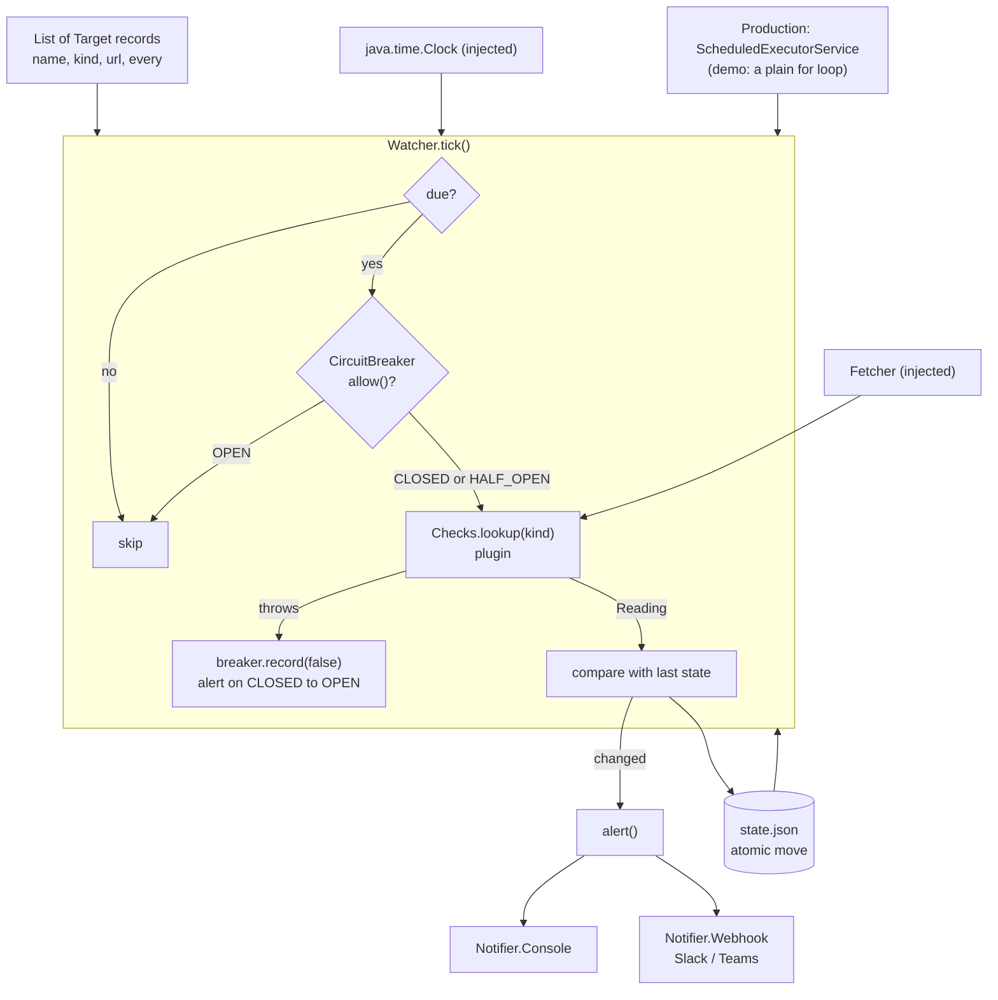
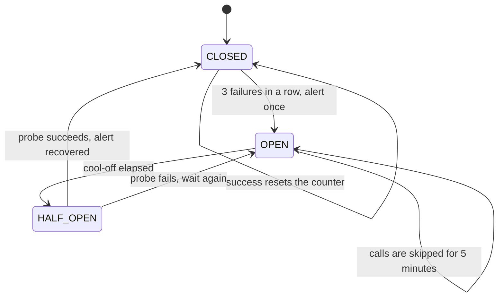
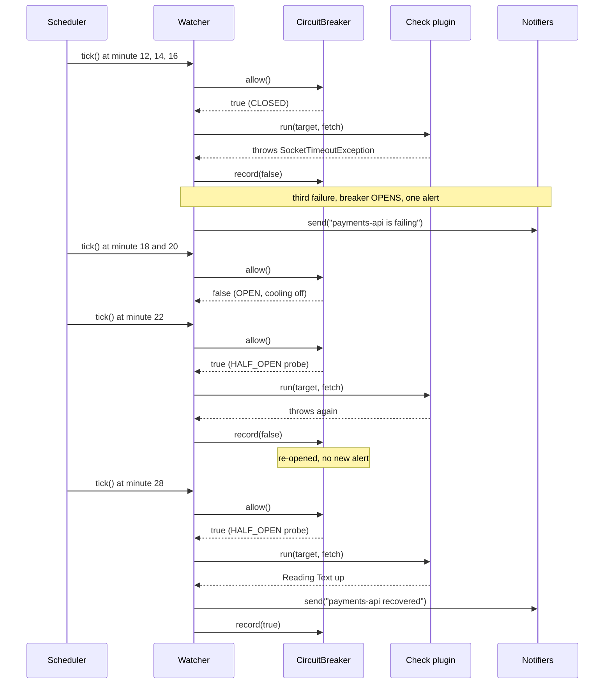

# Blueprint 3 (Java) — Site & Price Watcher (automation + monitoring)

> **Automation back-end.** The pattern behind uptime monitors, price trackers, compliance checkers, scheduled reports and "tell me when X changes" bots: run small jobs on a schedule, remember what you saw, speak up **only when something changed**, and survive a bad day on the internet. This is the Java 21 twin of the Python blueprint: same story, same four alerts, JDK only.

**Stack:** Java 21 · `record` / `sealed` / `enum` · `java.time.Clock` · `java.util.regex` · `MessageDigest` (SHA-256) · `java.nio.file` · functional interfaces · `ScheduledExecutorService` (production shell only) · `java.net.http.HttpClient` (production shell only)
**Files:** `Watcher.java` (engine) · `Checks.java` (plugin registry) · `CircuitBreaker.java` · `Notifier.java` · `StateStore.java` · `Target.java` · `Reading.java` · `Fetcher.java` · `Check.java` · `Production.java` (never run by the demo) · `Demo.java` (40 simulated minutes in a few milliseconds)
**Prerequisites:** Day 15 (files), 17 (exceptions, logging), 18 (`java.time`), 20 (enums, records, sealed), 22 (functional interfaces), 23 (regex). Pairs well with the other two blueprints.

---

## 1. What problem is this solving?

You want to know when a laptop drops 5 % in price, when a changelog page changes, and whether your payment API is down. Doing it badly is easy: a `while (true)` loop that hits every site every second and e-mails you 400 times during an outage. Doing it well means:

1. **Schedule** — each target has its own rhythm (every 2 min vs every 10 min).
2. **Plugins** — a new kind of check should not require editing the engine.
3. **Memory** — compare with the *previous* value, and remember it across restarts.
4. **Alert on transitions** — "went down", "recovered", "price dropped", not "still down" 400 times.
5. **Politeness and resilience** — stop calling a dead service (circuit breaker); never corrupt your own state file.
6. **Testability** — the clock and the internet are *parameters*, so a test can live 40 minutes in 5 ms.

## 2. The big picture



## 3. The circuit breaker (the idea worth stealing)

The Python version *inferred* "half-open" from a timestamp. Java makes it a named state with an `enum`, and the cool-off is measured by an **injected `Clock`**.



During the simulated outage the watcher made **3 failing calls, 1 failing probe and 1 successful probe**, instead of hammering the API every two minutes for 16 minutes. The owner got **two** messages about it (failing, recovered), not twenty. The whole demo makes **31** fake HTTP calls instead of 123.

### One failing target, over time



## 4. Each idea in Java

### 4.1 Plugin registry (no decorators, so an explicit `register`)

```java
private static final Map<String, Check> REGISTRY = new ConcurrentHashMap<>();

static {
    register("price", Checks::price);          // a method reference IS a Check
    register("content", Checks::content);
    register("uptime", Checks::uptime);
}

public static void register(String kind, Check check) { REGISTRY.put(kind, check); }
```

```java
@FunctionalInterface
public interface Check {
    Reading run(Target target, Fetcher fetch) throws Exception;
}
```

The engine only ever says `Checks.lookup(t.kind()).run(t, fetch)`. Adding a "keyword" check is one more `Checks.register("keyword", (t, f) -> ...)` call, anywhere, with zero edits to `Watcher`. An unknown kind throws `IllegalArgumentException`, which the tick treats like any other failed check.

### 4.2 Time and network are parameters

```java
Watcher w = new Watcher(targets, net::fetch, List.of(notifier), stateFile, clock);
clock.set(START.plus(Duration.ofMinutes(10)));    // "it is now 10 minutes in"
w.tick();
```

Production passes `Clock.systemUTC()` and a lambda around `HttpClient`; the demo passes a `FakeClock` (an abstract `java.time.Clock` with three tiny methods) and a `FakeInternet`. **If you cannot test it without waiting or without internet, the design is leaking.** Note that `Watcher` never calls `Thread.sleep`: `tick()` does one round of work and returns.

### 4.3 Alert on transitions, with sealed types

```java
Reading old = state.put(t.name(), value);
if (old == null || old.equals(value)) return;          // first sighting, or unchanged: stay quiet
switch (value) {
    case Reading.Price now when old instanceof Reading.Price was && was.value() > 0 -> { ... price drop rule ... }
    default -> alert(t.name() + " changed", old.display() + " -> " + value.display());
}
```

```java
public sealed interface Reading permits Reading.Price, Reading.Text { ... }
```

`Reading` is a **sealed** interface with two `record` implementations, so `StateStore` can `switch` over it with no `default` and the compiler warns you if a third kind is ever added. For the breaker: `before == CLOSED && after == OPEN` is the edge that alerts, and a failed HALF_OPEN probe re-opens quietly.

### 4.4 Atomic file writes (with the Windows retry)

```java
Path tmp = Files.createTempFile(dir, "state-", ".tmp");     // same folder, same file system
Files.writeString(tmp, toJson(state));
Files.move(tmp, path, StandardCopyOption.ATOMIC_MOVE);      // readers see the old file or the new one
```

If the machine loses power mid-write, the *old* file is still intact. **Real-world wrinkle (same as the Python blueprint):** on **Windows** an antivirus scanner or the search indexer can hold the target for a few milliseconds and the move fails with `AccessDeniedException`. `StateStore` retries 8 times with growing pauses (20, 40, 60 ms ...) and falls back to `REPLACE_EXISTING` on the rare file system that cannot do atomic moves. A missing or corrupt state file simply means "start fresh".

### 4.5 One bad notifier must not break the rest

```java
for (Notifier n : notifiers) {
    try {
        n.send(title, body);
    } catch (Exception e) {
        LOG.log(Level.WARNING, "notifier " + n.getClass().getSimpleName() + " failed", e);
    }
}
```

`Notifier.send` declares `throws Exception` (a webhook can fail in many ways), so catching it per notifier is what keeps a 3 a.m. system boring.

### 4.6 The scheduler shell (compiled, never run by the demo)

```java
ScheduledExecutorService scheduler = Executors.newSingleThreadScheduledExecutor();
scheduler.scheduleWithFixedDelay(() -> {
    try {
        watcher.tick();
    } catch (RuntimeException e) {          // MUST catch: a task that throws is silently cancelled forever
        LOG.log(Level.SEVERE, "tick failed", e);
    }
}, 0, 5, TimeUnit.SECONDS);
```

This is Python's `run_forever(w, sleep, clock)` replaced by the idiomatic Java tool. `tick()` and `status()` are `synchronized`, so a status-page thread can read while the scheduler thread works. See `Production.java`.

## 5. Where Java does the work

| Java feature | Where | Course day |
|---|---|---|
| `enum` with a `switch` expression | `CircuitBreaker.State`, `allow()` | 20 |
| `record` with a compact constructor (validation) | `Target`, `Watcher.Status`, `Notifier.Alert` | 20 |
| `sealed interface` + pattern `switch` | `Reading`, `compare`, `StateStore.toJson` | 20 |
| interfaces with several implementations | `Notifier.Console`, `Notifier.Webhook` | 20 |
| functional interfaces and lambdas | `Fetcher`, `Check`, `Notifier.Poster` | 22 |
| method references (`Checks::price`, `net::fetch`) | plugin registration, injecting the fake web | 12, 22 |
| `Optional` | `lastSeen`, `status` | 22 |
| `Map`, `List.copyOf`, `computeIfAbsent`, `LinkedHashMap` | registry, breakers, due times | 9–10 |
| `java.time.Clock`, `Instant`, `Duration` | injected time, cool-off, `every` | 18 |
| `Pattern` / `Matcher` groups | pulling `1,299.00` out of HTML | 23 |
| `MessageDigest` + `HexFormat` | page fingerprint | 18 |
| `Path`, `Files.writeString`, `Files.move(ATOMIC_MOVE)`, `Files.walk` | state file and demo cleanup | 15 |
| try/catch in loops, custom exception, `UncheckedIOException` | resilient `tick`, `LayoutChangedException` | 17 |
| `java.util.logging` | notifier failures, scheduler errors | 17 |
| `String.format(Locale...)` | `%.0f`, `%,.2f` (always pass a Locale for stable output) | 4 |
| `ScheduledExecutorService` | `Production.start` | beyond day 30 (concurrency) |

## 6. The patterns, and why each one is here

| Pattern | In this code | Payoff |
|---|---|---|
| **Plugin registry** | `Checks.register` + `lookup` | extend without editing the engine |
| **Scheduler tick** | `Watcher.tick()` + `due` map | simple, deterministic, testable |
| **Circuit breaker (state machine)** | `CircuitBreaker` + `State` enum | stops hammering failing services |
| **Observer / notifier interface** | `Notifier` | add Slack, e-mail, SMS freely |
| **Alert on state change** | `compare`, breaker edge | no alert fatigue |
| **Atomic persistence** | `StateStore.save` | crash-safe memory |
| **Injected clock + network** | `Clock`, `Fetcher` | millisecond tests |
| **Fail-soft loops** | `try/catch` per target and per notifier | one problem never stops the rest |
| **Fail loud on layout change** | `LayoutChangedException` | wrong data is worse than no data |
| **Functional core, imperative shell** | `Production` wraps the pure-ish `Watcher` | the engine never sleeps or does real I/O itself |

## 7. What breaks in production (and the fix)

| Problem | Fix |
|---|---|
| Sites block you | respect `robots.txt`, set a clear `User-Agent` (done in `httpFetcher`), add random jitter to `every`, honour `Retry-After` |
| A layout change gives a wrong price (`$1` from a coupon) | tighten the regex, validate ranges (price within 50–150 % of last), alert on parse failure (already done) |
| A scheduled task throws and the executor silently stops it | catch `RuntimeException` inside the task (as `Production.start` does) and log it |
| Two copies of the watcher run | a lock file (`FileChannel.tryLock`), or run it as one scheduled job in cron / Task Scheduler / Kubernetes CronJob |
| State file grows or is shared by many workers | move to SQLite or Redis behind the same `load` / `save` shape |
| Thousands of targets or slow sites | virtual threads (`Executors.newVirtualThreadPerTaskExecutor()`) to check due targets in parallel, keep the breaker per target |
| Wall-clock jumps (NTP, daylight saving) | `Clock.systemUTC()` is fine for cool-offs here; for strict intervals prefer `System.nanoTime()` behind the same `Clock`-style interface |
| Secrets (webhook URLs) in code | environment variables (`System.getenv`) or a secrets manager; never commit them |
| Silent death | an external "dead-man's switch" (healthchecks.io style): the watcher pings it every run; no ping means someone pages you |

## 8. Run it

```text
cd java\blueprints\03_site_watcher
javac -d out *.java
java -cp out Demo
```

Or press **Run** in the portal, which does exactly that in a temporary folder. The demo is deterministic, takes well under a second, exits with code 0, and removes its temp files.

The expected story: the laptop drops 15 % (alert), the payment API fails three times (alert, breaker opens), is probed once and fails (quiet), is probed again and works (alert), and the changelog changes (alert). **4 alerts** from **31** fake HTTP calls. Then the dashboard, a restart that remembers the last price, and a layout change reported as an error.

To run it for real, start `Production` instead: it uses the system clock, `HttpClient`, and a `ScheduledExecutorService`.

```text
java -cp out Production
```

## 9. Differences from the Python version

| Python | Java | Why |
|---|---|---|
| `@check("price")` decorator fills `CHECKS` | explicit `Checks.register("price", Checks::price)` | Java has no function decorators; a registry call or an annotation scan does the job |
| `now: float` passed to `tick(now)` | `Clock` injected once, `tick()` reads it | the idiomatic `java.time` way; breaker also gets the clock |
| breaker state inferred from `opened_at` | explicit `enum State` with `HALF_OPEN` | the diagram and the code finally match |
| targets are dicts | `record Target` with validation | typos in a key fail at compile time instead of at 3 a.m. |
| values are "float or str" | `sealed interface Reading` | the compiler checks every `switch` is complete |
| `Notifier` is a `Protocol` (structural) | `Notifier` is an interface (nominal) | Java must say `implements`; a lambda also works |
| `json` module | tiny hand-written flat JSON writer and reader | the JDK has no JSON library; fine for numbers and strings |
| `time.sleep` in `run_forever` | `ScheduledExecutorService` in `Production` | Java scheduling belongs to an executor, not a hand-made loop |
| optional FastAPI status page | `Watcher.status()` returns a map you can expose with `HttpServer` (Day 30) | no framework in the JDK-only version |
| `hashlib.sha256(...).hexdigest()[:12]` | `MessageDigest` + `HexFormat`, first 12 hex chars | same algorithm, a few more lines (and a checked exception) |

## 10. Build it yourself — milestones

1. **Add `kind: "keyword"`** — alert when a word (e.g. "in stock") appears on the page. One `Checks.register("keyword", ...)` lambda that returns `new Reading.Text("present")` or `"absent"`.
2. **Add an e-mail notifier** as a new `Notifier` implementation that reads credentials from `System.getenv`. Test it with a fake `Poster`-style interface, not a real SMTP server.
3. **Add a rolling minimum.** Alert only when the price is the lowest seen in 30 days (store the minimum, with its `Instant`, in the state file).
4. **Add `/status` to your phone.** Use the JDK's `com.sun.net.httpserver.HttpServer` (Day 30) to return `watcher.status()` as JSON, beside the scheduler.
5. **Write JUnit 5 tests** (Day 24) with a `FakeClock`: the breaker opens after 3 failures, probes after the cool-off, closes on success, and the notifier receives exactly two alerts.
6. **Go parallel.** Run all due targets with virtual threads and `invokeAll`, keep one `CircuitBreaker` per target, and make the state map a `ConcurrentHashMap` (or keep `tick` synchronized and parallelise only the fetches).
